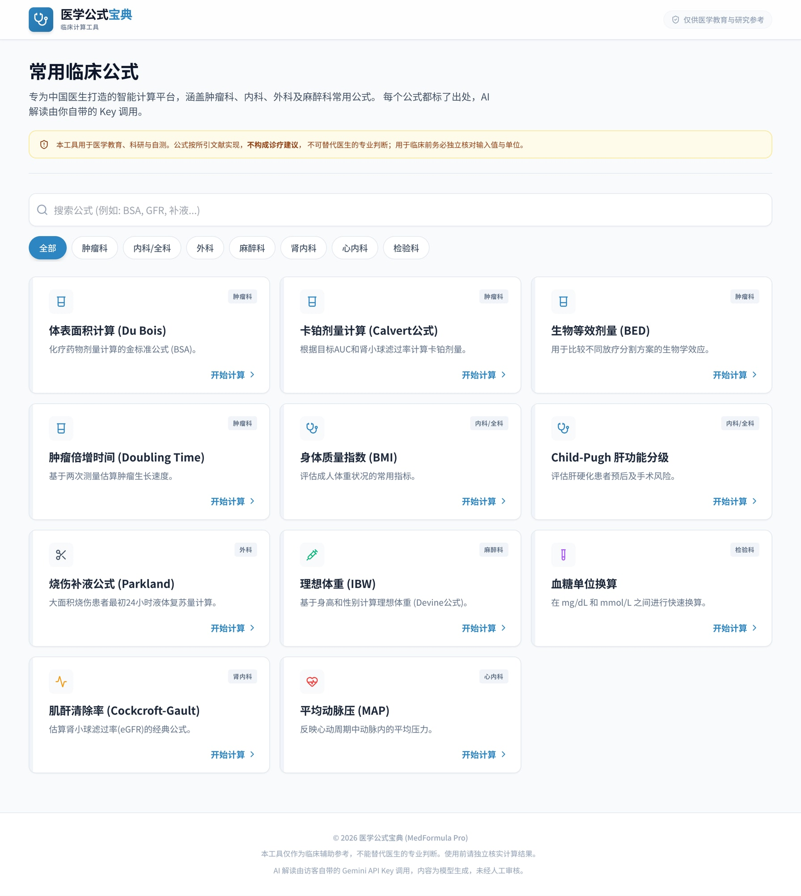

# 医学公式宝典 · 面向肿瘤科的临床计算工具集

> 把散落在指南、说明书和 Excel 里的临床公式，做成医生能在 10 秒内用上的网页工具：**输入即算、每个公式都带文献出处、结果可一键做 AI 语境解读**。
>
> **在线体验**：https://echoluo525-dot.github.io/medical-formula-toolkit/ （无需安装，计算全在本地完成）



---

## 一、为什么做它

MDCalc 这类工具在英文世界很好用，但中国医生的实际工作里常常卡在三件事上：**单位不一致**（mg/dL vs µmol/L）、**没有中文的量表与分期**、以及**拿不到公式的原始出处去核对**。

这个工具从最常用的 11 个公式起步，先解决"用得对"：

- **每个公式都标文献**：Du Bois 1916、Calvert 1989、Fowler 1989、Child-Turcotte 1964、Cockcroft-Gault 1976…… 结果页直接显示出处，医生能自己核对。
- **单位写死、说明写清**：胆红素给 mg/dL 并标注 ≈17.1 µmol/L，白蛋白给 g/dL 并标注 =10 g/L，Calvert 的 GFR 上限 125 mL/min 做成显式开关——**这些都是真实临床里最容易错的地方**。
- **输入即算、不做提交按钮**：改一个参数结果立刻更新，接近纸笔的手感。
- **AI 解读只做语境，不做诊断**：AI 不会给用药医嘱，只解释"这个数值意味着什么 + 最容易踩的前提陷阱"。

## 二、已实现

| 科室 | 公式 | 说明 |
|---|---|---|
| 肿瘤科 | 体表面积 BSA（Du Bois） | 化疗剂量计算的基准 |
| 肿瘤科 | 卡铂剂量（Calvert） | AUC × (GFR + 25)，含 GFR 上限开关 |
| 肿瘤科 | 生物等效剂量 BED | 比较不同放疗分割方案的生物学效应 |
| 肿瘤科 | 肿瘤倍增时间 | 依据两次影像测量估算生长速度，含风险分层 |
| 内科/全科 | BMI | 采用中国标准（24 / 28 分界） |
| 内科/全科 | Child-Pugh 分级 | 五项计分 → A/B/C 级 |
| 外科 | Parkland 补液 | 4 mL × kg × %TBSA，含前 8 小时分配 |
| 麻醉科 | 理想体重 IBW（Devine） | 按性别与身高 |
| 肾内科 | 肌酐清除率（Cockcroft-Gault） | 含女性 0.85 校正 |
| 心内科 | 平均动脉压 MAP | DBP + 1/3 脉压 |
| 检验科 | 血糖单位换算 | mg/dL ↔ mmol/L（×18） |

<table>
<tr>
<td></td>
<td></td>
</tr>
<tr><td align="center">输入即算 + 文献出处</td><td align="center">自带 Key 的 AI 解读</td></tr>
</table>

## 三、关于 AI 解读的一个取舍

这里没有把 Gemini 的 Key 打进前端。原因很直接：**静态站点里的任何 Key 都是公开的**，等于替所有人付账单。所以：

- 计算功能完全不依赖网络和 Key，打开就能用；
- 想用 AI 解读，填入自己的 Gemini Key（存在浏览器 localStorage，不经过任何第三方服务器）；
- `@google/genai` 采用按需加载，只在实际点击解读时下载，首屏只为计算付代价。

## 四、工程

- React 19 + TypeScript + Vite + Tailwind（**构建期编译**，不依赖 Tailwind CDN）
- 公式用声明式数据描述：`constants.ts` 里每个 `Formula` 自带 `inputs`、`calculate`、`reference`——加公式只需要加一条数据，不改组件
- 纯静态部署到 GitHub Pages，CI 跑 `tsc --noEmit` + `vite build`

```
├── constants.ts          # 公式数据（输入项、计算函数、文献出处）
├── types.ts              # Formula / InputType / CalculationResult
├── components/
│   ├── FormulaList.tsx   # 搜索 + 科室筛选
│   └── Calculator.tsx    # 输入即算、结果解读、AI 解读入口
└── services/
    ├── aiKey.ts          # 访客自带 Key 的本地保管
    └── geminiService.ts  # 按需加载的 AI 解读
```

## 五、Roadmap

- [ ] 量表：把手里那份 262 个量表的清单按使用频率分三批接进来（首推 NRS 2002、ECOG PS、KPS、mMRC）
- [ ] 分期：TNM / CSCO / FIGO 分期速查（已有癌肿—分期映射表）
- [ ] 化疗手册：方案剂量与预处理速查
- [ ] 用药助手：肾功能剂量调整
- [ ] 计算历史与导出（便于写病程记录时复述）

## 六、免责声明

本工具用于**医学教育、科研与自测**。公式按所列文献实现，但结果**不构成诊疗建议**，不可替代医生的专业判断；用于临床前请务必独立核对输入值与单位。AI 解读为模型生成内容，未经人工审核。
